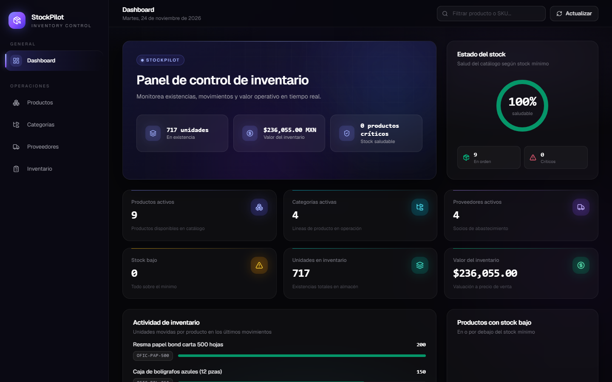
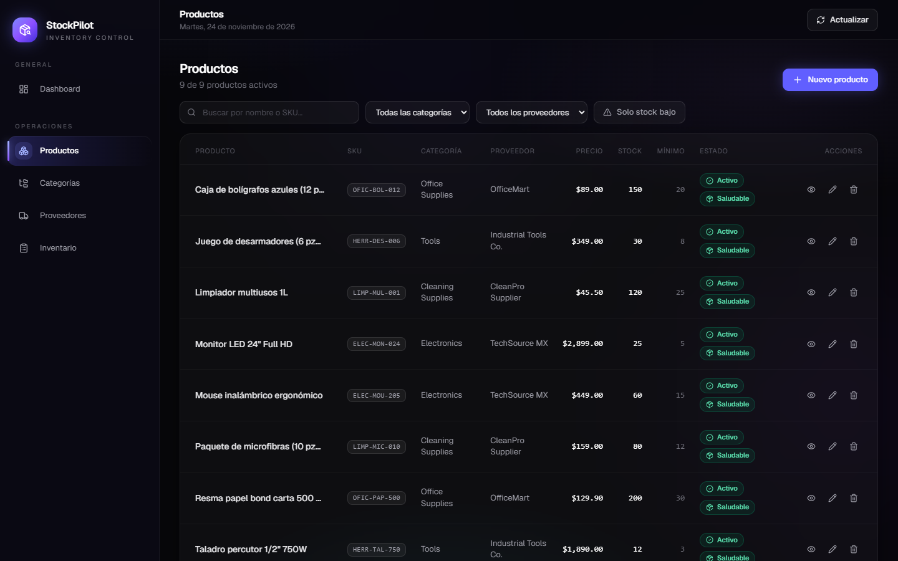
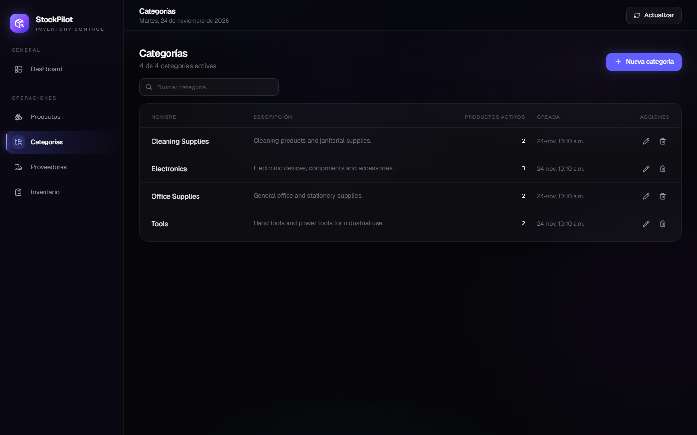
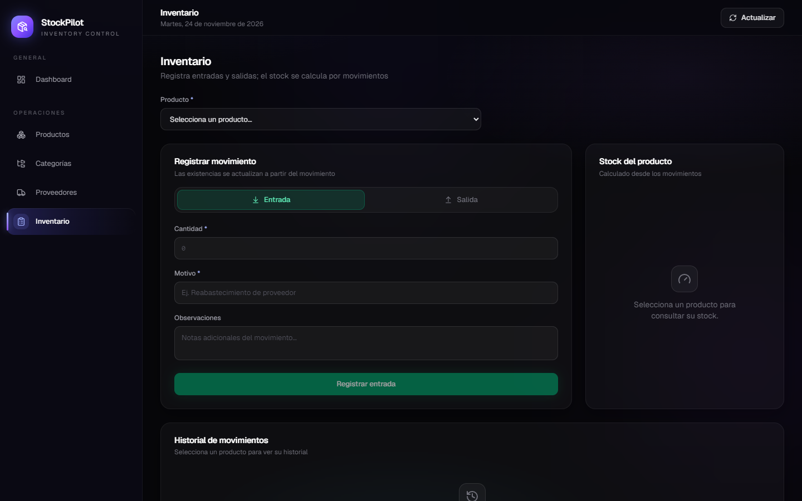

# StockPilot — Inventory Control (ASP.NET Core + React)

An inventory system for products, categories, suppliers and stock movements. It has a REST API in **ASP.NET Core 9 / EF Core 9 / SQL Server** and a **React 19 + TypeScript** dashboard.

    [](https://github.com/JovanySk/stockpilot/actions/workflows/ci.yml)

## Screenshots

| Dashboard | Products |
|---|---|
|  |  |
| **Categories** | **Inventory movements** |
|  |  |

## Architecture

```text
React 19 + TS (Vite, Tailwind, shadcn/ui, Recharts, Axios)
        │  /api
        ▼
ASP.NET Core 9 ── Controllers/Api (5 controllers, 24 endpoints)
        │
        ▼
Services (interfaces + ServiceResult<T>)  ──►  EF Core 9  ──►  SQL Server 2022
```

- **24 REST endpoints:** categories (6), suppliers (6), products (7), inventory (4) and dashboard (1).
- **Stock as a ledger:** stock is never edited directly. It is the sum of entry and exit movements, so every change keeps a reason, a user and a timestamp.
- **Business rules in the service layer:**
  - unique SKU;
  - no exits beyond the available stock;
  - no movements on inactive products;
  - a category with active products can't be deactivated;
  - low-stock detection against each product's minimum.
- **Dashboard:** 6 KPIs (units, inventory value, low stock, active products, categories and suppliers), a stock-health gauge and recent activity.

## Tests

`tests/StockPilot.Tests`: **16 xUnit tests** of the service layer. They run against **SQLite in-memory**, so unique indexes, foreign keys and SQL aggregates behave like a real database. CI runs them on every push and also builds the React client.

```bash
dotnet test StockPilot.sln
```

## Run it

```bash
# SQL Server 2022 + API (http://localhost:5116)
docker compose up --build

# React client (http://localhost:5173, proxies /api to :5116)
cd InventorySystem_ASPNETCore/client && npm ci && npm run dev
```

To run the API without Docker, set `ConnectionStrings__DefaultConnection` (or use `dotnet user-secrets`). No password is committed. The database is migrated and seeded on startup.

---
Author: **Jovany Morales del Ángel** · MIT License
